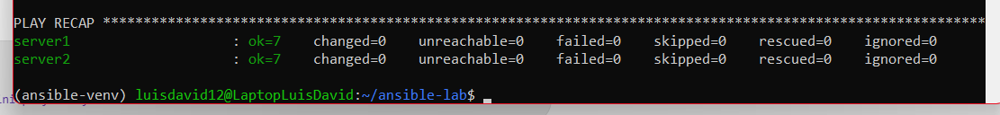

# Laboratorio Docker y Ansible

## Descripción
Este proyecto implementa dos servidores Ubuntu 24.04 utilizando Docker Compose y los administra mediante Ansible.

## Tecnologías utilizadas
- Ubuntu 24.04
- Docker y Docker Compose
- Ansible Core 2.21.6
- Python 3.12.3

## Estructura del proyecto

- `docker-compose.yml`: configuración de los dos contenedores Ubuntu.
- `inventory.ini`: inventario de servidores para Ansible.
- `playbook.yml`: tareas de administración automatizadas.
- `README.md`: documentación del proyecto.
- `captura-playbook.png`: evidencia de ejecución del playbook.

## Iniciar los servidores

Ejecutar:

```bash
docker compose up -d
```

Verificar los contenedores:

```bash
docker ps
```

## Probar la conexión con Ansible

```bash
ansible docker -i inventory.ini -m ansible.builtin.ping
```

## Ejecutar el playbook

```bash
ansible-playbook -i inventory.ini playbook.yml
```

## Tareas realizadas

1. Obtener información de los servidores.
2. Mostrar el nombre de cada servidor.
3. Identificar el sistema operativo y su versión.
4. Crear el directorio `/tmp/ansible-demo`.
5. Crear el archivo `info.txt`.
6. Crear los subdirectorios `logs`, `backup` y `config`.
7. Mostrar un mensaje cuando el sistema operativo sea Ubuntu.

## Verificación

La ejecución final del playbook terminó correctamente en ambos servidores:

- server1: `failed=0`
- server2: `failed=0`

También se verificó la existencia de los directorios y archivos creados dentro de ambos contenedores.

## Evidencia


